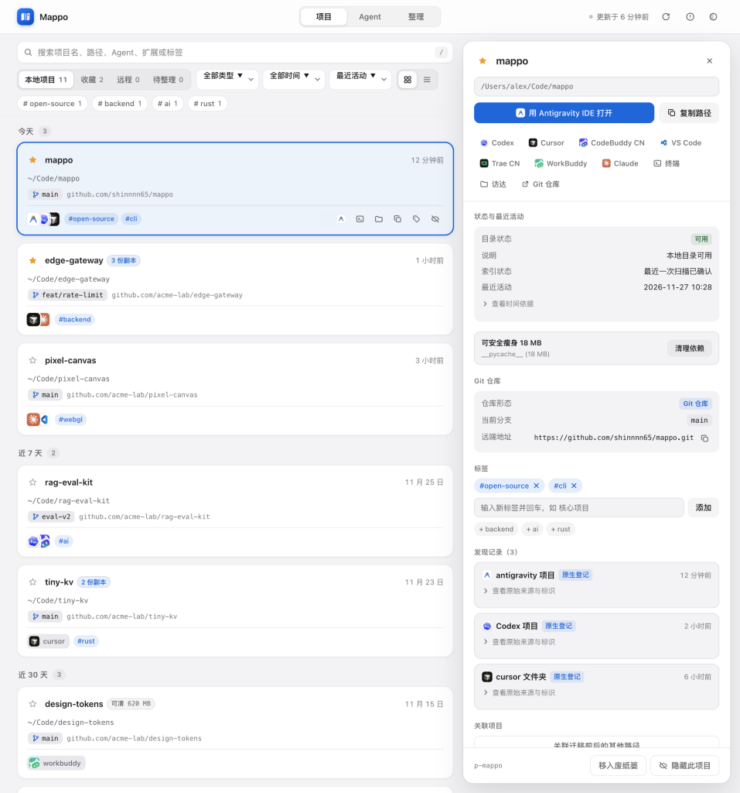
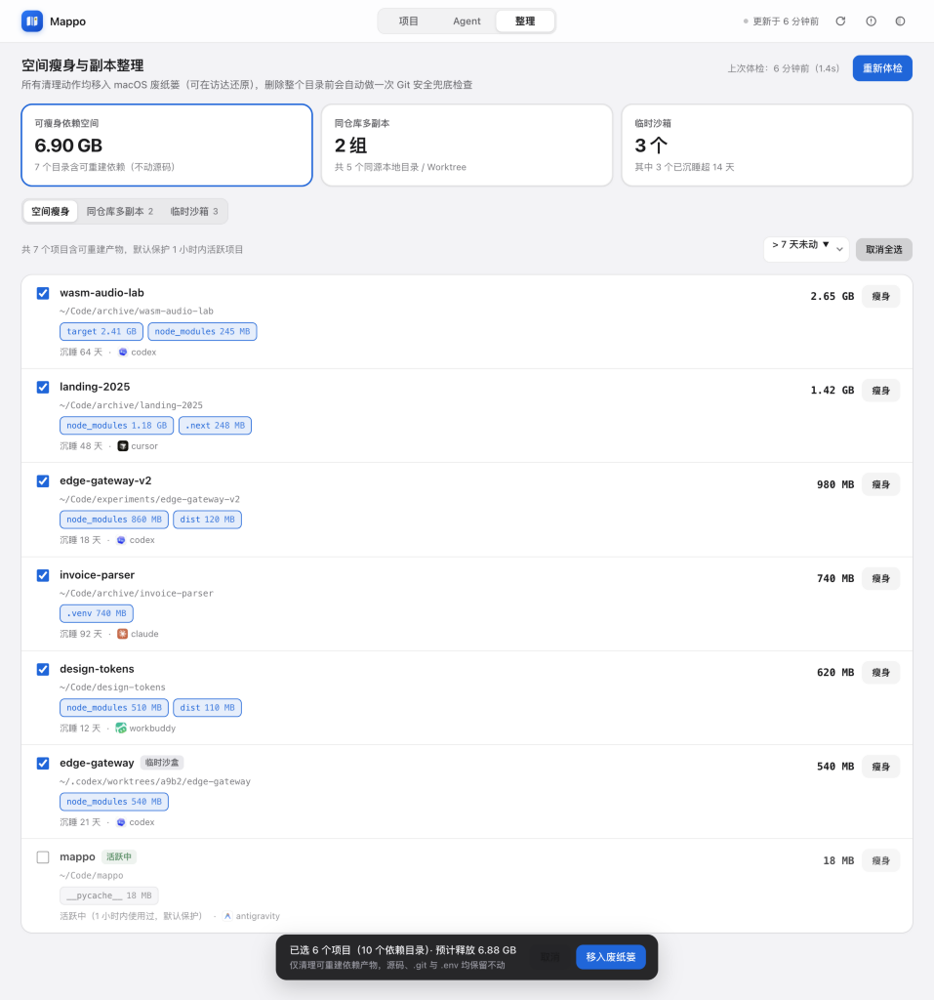
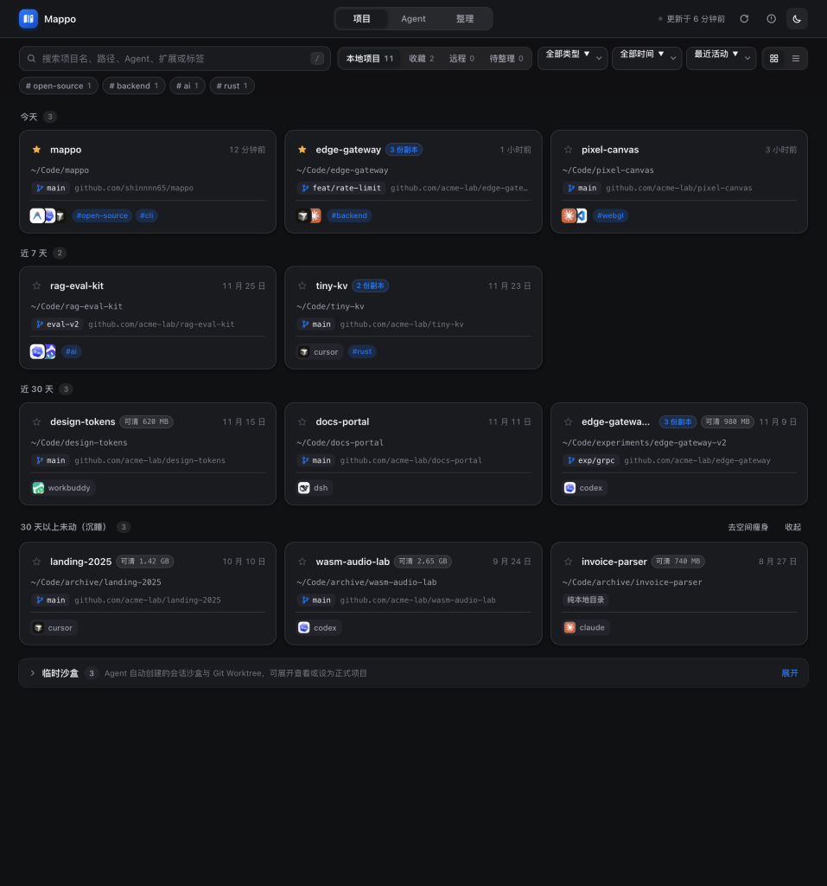

<p align="center">
  
</p>

<h1 align="center">Mappo</h1>

<p align="center">
  <strong>Local workspace map, quick launcher, and safe disk hygiene hub for macOS Coding Agents &amp; IDEs.</strong>
</p>

<p align="center">
  <a href="README.md">English</a> · <a href="README.zh-CN.md">简体中文</a>
</p>

<p align="center">
  
  
  
  
</p>

---

**Mappo** inventories every project and workspace touched by your local Coding Agents, editors, and extensions on macOS — giving you a fast local Web UI, an agent-friendly `--json` CLI, one-click launch into the most recently active tool, and safe macOS Trash cleanup for dormant build artifacts, duplicate clones, and agent sandboxes.

<p align="center">
  
</p>

## Why Mappo?

Modern AI-assisted development scatters projects across **5–8 Coding Agents and editors**, multiple local clones, Git worktrees, and temporary sandboxes:

- **One local map across all tools**: Aggregates Codex, Cursor, Claude Code, Antigravity (Desktop / IDE / CLI), CodeBuddy CN, WorkBuddy, DeepSeek Harness, VS Code, Trae, and editor extensions — ordering every project's tools by real `last_activity`.
- **Safe hygiene, never `rm -rf`**: Finds gigabytes of rebuildable dependencies (`node_modules`, `.venv`, `target`, `.next`, contextual `dist`/`build`), groups duplicate clones of the same Git remote, runs an on-demand Git safety check before deleting whole directories, and moves everything to **macOS Trash** (reversible via Finder).
- **Zero-dependency CLI + Agent Skill**: Runs on stock Python 3.9+ standard library, ships as a single-file `mappo.pyz`, and includes a ready-to-use [`skills/mappo/SKILL.md`](skills/mappo/SKILL.md) so any AI agent can query your local workspace map via `--json`.

---

## Screenshots

<table>
  <tr>
    <td><strong>Organize &amp; Disk Hygiene</strong> — Progressive scan for rebuildable dependencies, duplicate repos, and sandboxes</td>
    <td><strong>Dark Mode</strong> — Time-bucketed local projects with duplicate &amp; reclaimable indicators</td>
  </tr>
  <tr>
    <td></td>
    <td></td>
  </tr>
</table>

---

## Supported Tools

| Tool | Local Read-Only Evidence | One-Click Launch |
| --- | --- | --- |
| **Codex** | `state_*.sqlite` (`projects`, `project_roots`, `threads.cwd`) + desktop JSON fallback | `Codex.app` / `ChatGPT.app` (`com.openai.codex`) |
| **Cursor** | `workspaceStorage`, `recentlyOpenedPathsList`, multi-root `.code-workspace`, edit `History` | `Cursor.app` / `cursor` |
| **Claude Code / Desktop** | `.claude.json` projects &amp; `history.jsonl` | `Claude.app` |
| **Antigravity** | `~/.gemini/config/projects/*.json`, `conversation_summaries.db` (Desktop / IDE / CLI), `Antigravity IDE` workspaceStorage | `Antigravity IDE.app` / `Antigravity.app` |
| **CodeBuddy CN / CLI** | `workspaceStorage`, recent list, `codebuddy-sessions.vscdb`, bounded session JSONL edges | `CodeBuddy CN.app` / `codebuddy` |
| **WorkBuddy** | `workbuddy.db` (`workspaces`, `sessions.cwd`) &amp; desktop `sessions.json` | `WorkBuddy.app` |
| **DeepSeek Harness** | `workspace.json` workspaces &amp; `session_projcache` | `DeepSeek Harness.app` |
| **VS Code / Trae / Trae CN** | `workspaceStorage`, `recentlyOpenedPathsList`, multi-root configs, edit `History` | `Visual Studio Code.app` / `Trae.app` / `Trae CN.app` |
| **Editor Extensions** | Host editor workspace DB state keys (GitHub Copilot, Continue, Stagewise, CodeGeeX, Pencil) | Via host editor |
| **Custom Local Tools** | Optional `~/.config/mappo/custom_tools.json` for private/internal extensions and tools | — |

---

## Quick Start

Requires **macOS** and **Python 3.9+** (standard library only, no `pip install` needed).

### Option 1: Install the standalone `mappo.pyz`

Download `mappo.pyz` from [GitHub Releases](https://github.com/shinnnn65/mappo/releases) (or build it from source):

```sh
mkdir -p ~/.local/bin
curl -fsSL https://github.com/shinnnn65/mappo/releases/latest/download/mappo.pyz -o ~/.local/bin/mappo
chmod 755 ~/.local/bin/mappo

mappo --version
mappo scan
mappo web
```

### Option 2: Run from source

```sh
git clone https://github.com/shinnnn65/mappo.git
cd mappo
./mappo scan
./mappo web
```

Build your own single-file zipapp anytime:

```sh
python3 -B scripts/build_release.py dist/mappo.pyz
```

---

## Use as an Agent Skill

Mappo ships with a standard Agent Skill at [`skills/mappo/SKILL.md`](skills/mappo/SKILL.md) compatible with **Claude Code**, **Codex**, **Cursor**, **Antigravity**, and personal agent harnesses.

Once `mappo` is installed and the skill is added to your agent's skills directory, your agent can safely answer questions like:
- *"What projects did I touch in the last 7 days across Codex, Cursor, and Claude?"* → `mappo projects --indexed --recent --since 7d --json`
- *"Where is `edge-gateway` cloned on this Mac and which branch is each copy on?"* → `mappo projects --indexed --name edge-gateway --json`
- *"How much disk space can I safely reclaim from dormant `node_modules` or agent sandboxes?"* → `mappo hygiene --indexed --json`
- *"Open `mappo` in the tool I used most recently."* → `mappo open mappo --indexed`

The skill is strictly **read-only by default** — it never downloads binaries silently and never runs `rm -rf`.

---

## CLI Reference

```sh
# Scan and refresh local SQLite index (~/.local/state/mappo/index.sqlite)
mappo scan
mappo scan --json

# Query agents, projects, and workspaces
mappo agents
mappo projects --indexed --recent --since 7d
mappo projects --agent cursor --name gateway --json
mappo workspaces --agent codex --recent
mappo inspect <id> --indexed

# Launch a project (auto picks the most recently active editor or desktop agent)
mappo open <name-or-id> --indexed
mappo open <name-or-id> --indexed --with cursor
mappo open <name-or-id> --indexed --with codex
mappo open <name-or-id> --indexed --with terminal
mappo open <name-or-id> --indexed --with remote
mappo open <name-or-id> --indexed --dry-run --json

# Read-only disk hygiene & duplicate clone audit
mappo hygiene --indexed
mappo hygiene --indexed --json

# Organize local metadata (synced with Web UI)
mappo star <project-id>
mappo tag <project-id> core backend
mappo hide <project-id>
mappo link <old-project-id> <new-project-id>

# Diagnose permission or missing-source issues
mappo doctor --indexed

# Start local-only Web UI (http://127.0.0.1:4318)
mappo web
mappo web --port 4318 --no-open
```

---

## Local Web UI (`mappo web`)

- **Projects**: Time-grouped view (`Today`, `Last 7 days`, `Last 30 days`, `Dormant 30d+`), clickable `N copies` duplicate pills, reclaimable size hints, tags, favorites, remote workspace grouping, and a persistent detail drawer with per-project recent-first tool launchers.
- **Agents**: Active Coding Agents, editors, and host-attributed editor extensions, plus a collapsible list of detected tools without records.
- **Organize (Hygiene)**: Progressive background scanner for rebuildable dependencies (`node_modules`, `.venv`, `target`, `.next`, contextual `dist`/`build`), Git remote duplicate grouping, and agent sandbox cleanup. Trashing a whole directory runs an on-demand Git safety check (uncommitted changes, untracked files, unpushed commits, stashes, missing remote, local `.env` files) with a one-click fallback to *"Clean dependencies only"*.
- **Keyboard shortcuts**: `/` or `Cmd+K` search, `↑`/`↓` navigate, `Enter` details, `E` open in recent tool, `T` terminal, `O` Finder, `S` star, `R` rescan, `Esc` close.

---

## Privacy, Security & Design Guarantees

- **100% local, zero telemetry**: Never phones home; reads only known local metadata under your user account without `sudo` or Full Disk Access.
- **Read-only WAL-safe SQLite access**: Never creates WAL sidecars in foreign application directories; retries safely on database contention.
- **Localhost-only Web server**: Binds strictly to `127.0.0.1`; every mutating endpoint validates `Host`, `Origin`, and a per-session random `X-AWH-Token`.
- **Reversible Trash-only cleanup**: Strict path allowlisting rejects symlinks, non-artifact directories, and protected system/home paths; moves items via native macOS Trash (`/usr/bin/trash`) instead of `rm -rf`.

---

## Custom Local Tools (Optional)

To detect private or internal extensions/tools without modifying the codebase, create `~/.config/mappo/custom_tools.json` (or set `MAPPO_CUSTOM_TOOLS`):

```json
{
  "extensions": {
    "my-ext": {
      "name": "My Extension",
      "extension_id": "publisher.my-extension",
      "data_dir": ".my-extension"
    }
  },
  "products": {
    "my-agent": {
      "name": "My Agent",
      "data_dir": ".my-agent",
      "limit": "Local directory detected; workspace index not yet parsed"
    }
  }
}
```

---

## Development

```sh
python3 -B -m unittest -v
```

See [docs/architecture.md](docs/architecture.md) for module layering and how to add new read-only providers.

## License

[MIT License](LICENSE). Built for personal workflow sanity; bug fixes and new read-only tool adapter PRs are welcome.
