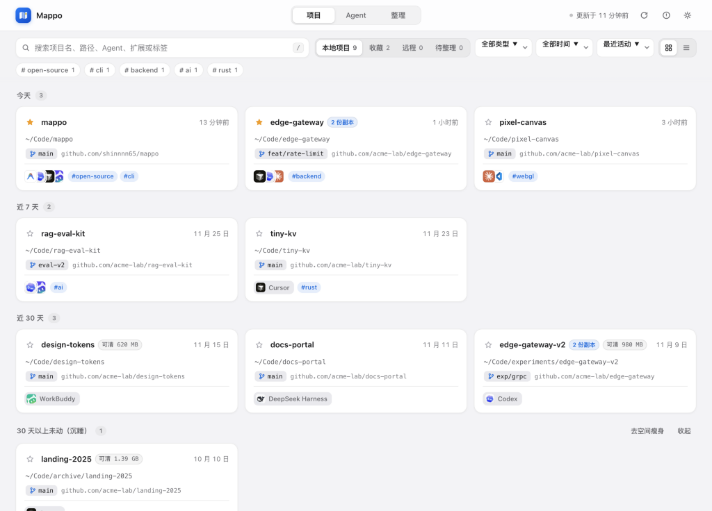
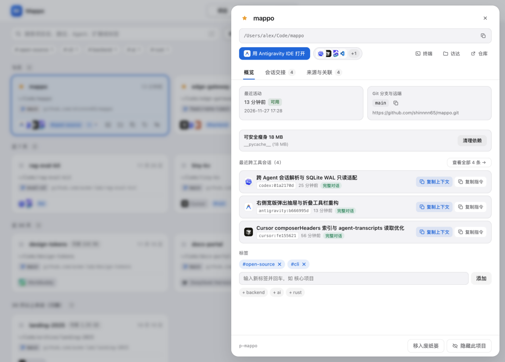
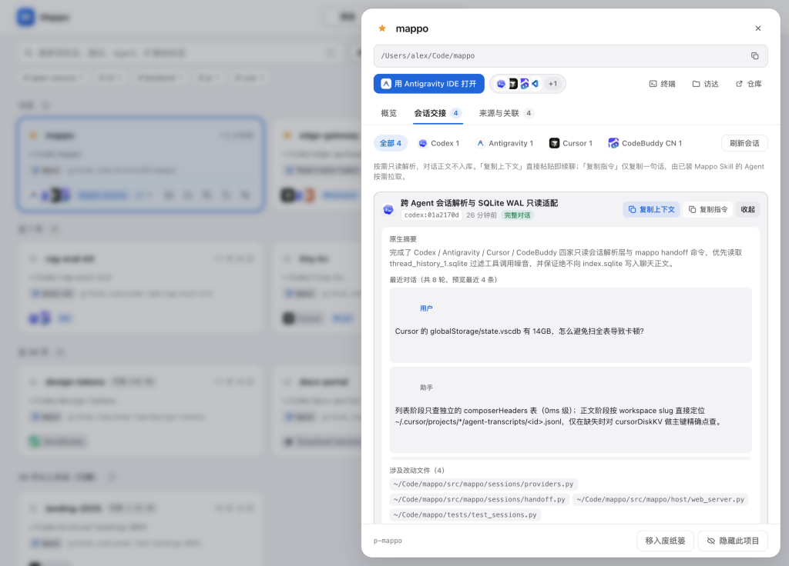
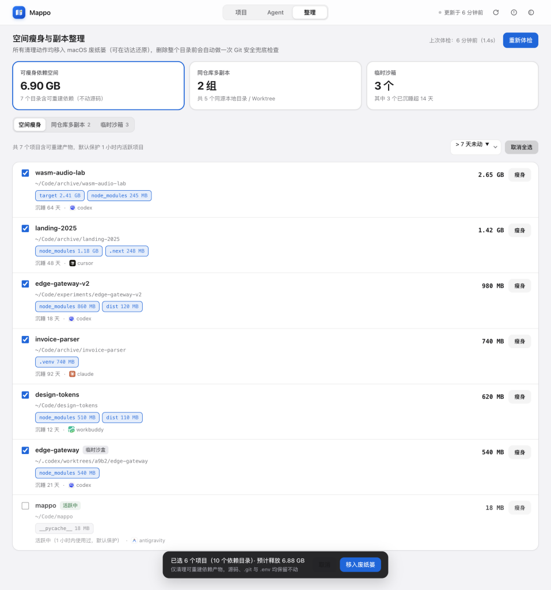

<p align="center">
  
</p>

<h1 align="center">Mappo</h1>

<p align="center">
  <strong>macOS Coding Agent 与 IDE 本地工作区地图、跨 Agent 会话交接、一键启动器与安全空间瘦身工具。</strong>
</p>

<p align="center">
  <a href="README.md">English</a> · <a href="README.zh-CN.md">简体中文</a>
</p>

<p align="center">
  
  
  
  
</p>

---

**Mappo** 在 macOS 上统一盘点本机 Coding Agent、编辑器和扩展使用过的所有项目工作区。提供轻快的本地 Web UI、面向 AI Agent 的 `--json` CLI、按项目内最近活跃工具一键打开，以及面向沉睡依赖产物、同仓库多副本与临时沙箱的**废纸篓安全清理**。

<p align="center">
  
</p>

## 为什么做 Mappo？

高频使用多个 AI 编程工具后，项目很快会散落在 **5～8 个 Agent/IDE**、多份本地 clone、Git worktree 与临时沙箱里：

- **一张跨工具的本机项目地图**：统一聚合 Codex、Cursor、Claude Code、Antigravity（桌面端 / IDE / CLI）、CodeBuddy CN、WorkBuddy、DeepSeek Harness、VS Code、Trae 及编辑器扩展，按每个项目真实的 `last_activity` 将最近活跃的工具排在最前面。
- **只读跨 Agent 会话交接**：按需读取 **Codex、Antigravity、Cursor、CodeBuddy** 的本地会话，直接粘贴 `codex://threads/...`、`codex resume ...`、`conversation://...` 或 `<agent>:<id>` 即可生成去噪后的 Markdown / JSON 上下文（原生摘要、最近对话、改动文件与实时 Git 状态），不修改任何第三方工具数据库。
- **安全瘦身，绝不 `rm -rf`**：按需扫描可 100% 重建的依赖与构建产物（`node_modules`、`.venv`、`target`、`.next`、带清单守卫的 `dist`/`build`），自动聚合同一 Git 远端的多份本地副本，删除整目录前现场做一次 Git 安全兜底检查，所有清理均移入 **macOS 废纸篓**（可在访达还原）。
- **零依赖单文件 CLI + Agent Skills**：仅依赖 Python 3.9+ 标准库，可打包为单文件 `mappo.pyz`，并自带 [`skills/mappo/SKILL.md`](skills/mappo/SKILL.md)（以及配套项目价值体检 Skill [`skills/project-value-audit/SKILL.md`](skills/project-value-audit/SKILL.md)），让任意 Coding Agent 都能查询你的本机工作区并无缝接续其他 Agent 的会话。

---

## 界面预览

<table>
  <tr>
    <td><strong>右侧宽版抽屉与折叠启动栏</strong> — 折叠头像式多工具启动器、独立的终端/访达/仓库入口，以及最近跨工具会话快捷交接</td>
    <td><strong>跨 Agent 会话交接与预览</strong> — 按需读取 Codex / Antigravity / Cursor / CodeBuddy 会话，一键复制上下文或短指令，并支持抽屉内预览</td>
  </tr>
  <tr>
    <td></td>
    <td></td>
  </tr>
</table>

<p align="center">
  <strong>整理与空间瘦身</strong> — 流式体检可重建依赖、同仓库多副本与临时沙箱，全部可还原移入废纸篓<br><br>
  
</p>

---

## 支持的工具

| 工具 | 只读本地证据 | 一键打开 |
| --- | --- | --- |
| **Codex** | `state_*.sqlite`（`projects`、`project_roots`、`threads.cwd`），旧版回退桌面 JSON | `Codex.app` / `ChatGPT.app`（`com.openai.codex`） |
| **Cursor** | `workspaceStorage`、`recentlyOpenedPathsList`、多根工作区与编辑 `History` | `Cursor.app` / `cursor` |
| **Claude Code / Desktop** | `.claude.json` 项目登记与 `history.jsonl` | `Claude.app` |
| **Antigravity** | `~/.gemini/config/projects/*.json`、桌面/IDE/CLI 会话摘要库与 `Antigravity IDE` workspaceStorage | `Antigravity IDE.app` / `Antigravity.app` |
| **CodeBuddy CN / CLI** | `workspaceStorage`、最近列表、`codebuddy-sessions.vscdb` 与限长会话首尾事件 | `CodeBuddy CN.app` / `codebuddy` |
| **WorkBuddy** | `workbuddy.db`（`workspaces`、`sessions.cwd`）与桌面 `sessions.json` | `WorkBuddy.app` |
| **DeepSeek Harness** | `workspace.json` 工作区登记与会话投影缓存 | `DeepSeek Harness.app` |
| **VS Code / Trae / Trae CN** | `workspaceStorage`、`recentlyOpenedPathsList`、多根配置与编辑 `History` | `Visual Studio Code.app` / `Trae.app` / `Trae CN.app` |
| **编辑器扩展** | 读取宿主编辑器工作区数据库状态键（GitHub Copilot、Continue、Stagewise、CodeGeeX、Pencil） | 通过宿主编辑器 |
| **自定义本地工具** | 可选 `~/.config/mappo/custom_tools.json` 扩展私有/内部工具 | — |

---

## 快速开始

需要 **macOS** 与 **Python 3.9+**（纯标准库，无需 `pip install`）。

### 方式一：安装单文件 `mappo.pyz`

从 [GitHub Releases](https://github.com/shinnnn65/mappo/releases) 下载（或自行构建）：

```sh
mkdir -p ~/.local/bin
curl -fsSL https://github.com/shinnnn65/mappo/releases/latest/download/mappo.pyz -o ~/.local/bin/mappo
chmod 755 ~/.local/bin/mappo

mappo --version
mappo scan
mappo web
```

### 方式二：从源码运行

```sh
git clone https://github.com/shinnnn65/mappo.git
cd mappo
./mappo scan
./mappo web
```

随时打包单文件发行包：

```sh
python3 -B scripts/build_release.py dist/mappo.pyz
```

---

## 作为 Agent Skill 接入

仓库内置标准 Agent Skill 文件 [`skills/mappo/SKILL.md`](skills/mappo/SKILL.md)，可直接接入 **Claude Code**、**Codex**、**Cursor**、**Antigravity** 或个人 Agent Harness。

安装 `mappo` 并加载 Skill 后，Agent 即可安全响应这类请求：
- “总结我这周在 Codex、Cursor、Claude 里动过哪些项目” → `mappo projects --indexed --recent --since 7d --json`
- “本机 `edge-gateway` 放在哪几个目录，各自在什么分支？” → `mappo projects --indexed --name edge-gateway --json`
- “体检一下哪些沉睡项目的 `node_modules` 或沙箱最占硬盘” → `mappo hygiene --indexed --json`
- “用最近用过的工具打开 `mappo`” → `mappo open mappo --indexed`
- “接着 `codex://threads/01a2170d-...` 或 `cd '...' && codex resume ...` 往下做” → `mappo handoff "<ref>" --turns 6`

仓库另附可选配套 Skill [`skills/project-value-audit/SKILL.md`](skills/project-value-audit/SKILL.md)，可结合 `mappo projects` 与 `mappo hygiene` 对本地个人项目做去情绪化的多维价值审计。

该 Skill 默认严格**只读**，不会静默下载二进制，也不会执行 `rm -rf`。

---

## CLI 常用命令

```sh
# 扫描并刷新本地索引（~/.local/state/mappo/index.sqlite）
mappo scan
mappo scan --json

# 检索工具、项目与工作区
mappo agents
mappo projects --indexed --recent --since 7d
mappo projects --agent cursor --name gateway --json
mappo workspaces --agent codex --recent
mappo inspect <列表中的ID> --indexed

# 一键打开（默认 auto 优先选用该项目最近活跃的编辑器或桌面 Agent）
mappo open <项目ID或名称> --indexed
mappo open <项目ID或名称> --indexed --with cursor
mappo open <项目ID或名称> --indexed --with codex
mappo open <项目ID或名称> --indexed --with terminal
mappo open <项目ID或名称> --indexed --with remote
mappo open <项目ID或名称> --indexed --dry-run --json

# 跨 Agent 会话查询与只读交接（Codex / Antigravity / Cursor / CodeBuddy）
mappo sessions --limit 15
mappo sessions --project my-app --json
mappo handoff "codex://threads/01a2170d-4a3f-7893-80a8-73f1ab793f8a" --turns 6
mappo handoff "cd '/path/to/repo' && codex resume 01a2170d-..." --json
mappo handoff cursor:a67d881f | pbcopy

# 只读空间体检与多副本报告
mappo hygiene --indexed
mappo hygiene --indexed --json

# 本地元数据管理（与 Web UI 共用索引）
mappo star <项目ID>
mappo tag <项目ID> 核心 后端
mappo hide <项目ID>
mappo link <旧项目ID> <新项目ID>

# 查看权限受限或缺失来源诊断
mappo doctor --indexed

# 启动本地 Web UI（http://127.0.0.1:4318）
mappo web
mappo web --port 4318 --no-open
```

---

## 本地 Web UI（`mappo web`）

- **项目视图**：按「今天 / 近 7 天 / 近 30 天 / 30 天以上未动」时间分层展示，自动标出 `N 份副本` 与大体积依赖提示；右侧宽版弹出蒙版抽屉按「概览 / 会话交接 / 来源与关联」分层，顶部提供折叠头像式多工具启动栏与独立的终端/访达/仓库入口。
- **跨 Agent 会话交接**：项目抽屉内按需加载该项目在 Codex、Antigravity、Cursor、CodeBuddy 下的最近会话，支持一键「复制上下文」（Markdown 粘贴即续聊）、「复制指令」（一句话发给已装 Mappo Skill 的 Agent）与抽屉内上下文预览。
- **Agent 视图**：区分 Coding Agent、编辑器与编辑器扩展（含宿主编辑器归属），折叠暂无记录的工具。
- **整理视图（Hygiene）**：后台渐进式扫描可重建依赖（`node_modules`、`.venv`、`target`、`.next`、带构建清单校验的 `dist`/`build`），聚合「同仓库多副本」与「临时沙箱」。移入废纸篓前按需跑一次 Git 安全检查（未提交改动、未跟踪文件、未推送提交、stash、无远端仓库、本地 `.env`），有风险时提供「改走仅清依赖」安全退路。
- **快捷键**：`/` 或 `Cmd+K` 搜索、`↑`/`↓` 选择、`Enter` 看详情、`E` 用默认工具打开、`T` 终端、`O` 访达、`S` 收藏、`R` 重新扫描、`Esc` 关闭。

---

## 隐私、安全与设计原则

- **纯本地零上报**：不连任何外部服务，仅以当前账号只读访问已知本地元数据，无需 `sudo` 或完全磁盘访问权限。
- **对话正文绝不入库**：`index.sqlite` 只存工作区路径与元数据；会话记录仅在你执行 `mappo handoff` 或在 Web UI 预览/复制时按需只读原文件。
- **SQLite WAL 只读安全**：不会在第三方应用目录里创建 `-wal`/`-shm` 副文件，遇数据库写入锁定自动重试。
- **仅限本机访问**：Web 服务仅绑定 `127.0.0.1`，所有变更接口严格校验 `Host`、`Origin` 与一次性会话令牌。
- **可还原的废纸篓清理**：白名单校验路径，拒绝符号链接、非依赖目录与系统/主目录，通过 macOS 原生废纸篓（`/usr/bin/trash`）移动而非 `rm -rf`。

---

## 自定义本地工具配置（可选）

如需在本机额外识别未内置的私有或内部扩展/工具，可在 `~/.config/mappo/custom_tools.json`（或环境变量 `MAPPO_CUSTOM_TOOLS`）添加：

```json
{
  "extensions": {
    "my-ext": {
      "name": "My Extension",
      "extension_id": "publisher.my-extension",
      "data_dir": ".my-extension"
    }
  },
  "products": {
    "my-agent": {
      "name": "My Agent",
      "data_dir": ".my-agent",
      "limit": "仅探测本地目录，暂未解析项目索引"
    }
  }
}
```

---

## 开发与测试

```sh
python3 -B -m unittest -v
```

目录分层与新适配器开发方式见 [docs/architecture.md](docs/architecture.md)。

## 许可证

采用 [MIT License](LICENSE) 开源。个人自用起家，按需维护，欢迎提交 Bug 修复与只读工具适配器 PR。
